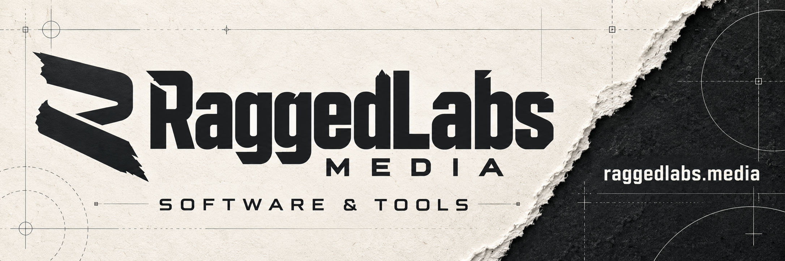

**Practical software and intelligent tools that simplify everyday digital tasks.**

RaggedLabs Media develops software and tools that reduce repetitive work, bring order to growing digital collections and make everyday tasks easier to manage.

Our name reflects our character: rough and ragged in style, with carefully engineered tools underneath. We combine AI-assisted development with thoughtful design, testing and continuous improvement to build software that is useful, clear and reliable.

## What we build

- **Media tools** to help people review, name and organise their collections.
- **Automation** that reduces repetitive tasks and simplifies digital workflows.
- **Practical utilities** for everyday computing and self-hosted environments.

## Our first product: Namerr

**Namerr** is our media library organisation tool, currently in development. It focuses on making it easier to review collections, understand proposed changes and keep media files organised.

## Contact

For product questions, feedback, collaboration or business enquiries:

- **Email:** [contact@raggedlabs.media](mailto:contact@raggedlabs.media)
- **Website:** [raggedlabs.media](https://raggedlabs.media)

Explore our public repositories below as projects become available.
